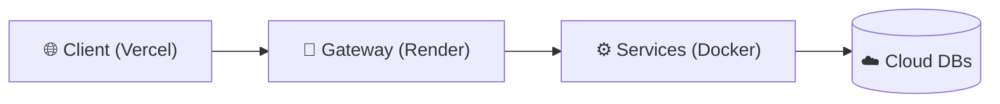

# ZeoAuction

A high-concurrency, distributed real-time auction platform built with a microservice architecture. Sellers must pass cryptographic KYC before listing, bids are atomically sequenced under contention, watchers experience live updates over WebSockets, and winning payments are protected via an automated escrow ledger.

---

## 🌐 Live Deployments

* **Live Web Application**: [https://zeo-auction-92pm.vercel.app](https://zeo-auction-92pm.vercel.app)
* **Vercel Project Dashboard**: [https://vercel.com/kenji16/zeo-auction-92pm](https://vercel.com/kenji16/zeo-auction-92pm)
* **API Gateway (Render)**: [https://zeo-api-gateway.onrender.com](https://zeo-api-gateway.onrender.com)
* **GitHub Repository**: [https://github.com/sagar-dot-bera/ZeoAuction](https://github.com/sagar-dot-bera/ZeoAuction)

---

## 🏗️ High-Level Architecture



* **Frontend**: React 18 Single-Page Application (SPA) built with Vite, TypeScript, and Tailwind CSS. Hosted on Vercel with global CDN invalidation.
* **API Gateway**: Nginx reverse proxy hosted on Render terminating SSL, enforcing centralized CORS policies, upgrading WebSockets, and routing requests to private backend services.
* **Backend Microservices**: 13 isolated Python/FastAPI services built on a shared base framework (`zeo-common`).
* **Cloud Infrastructure**:
  * **Database**: **NeonDB** (Serverless PostgreSQL with strict schema isolation per service).
  * **In-Memory Lock Store**: **Upstash Redis** (Atomic price locking and idempotency tracking over TLS).
  * **Event Bus**: **Aiven Kafka** (Deterministic sequential event streaming partitioned by auction ID).
  * **Object Storage**: **Supabase S3** (Presigned multi-part uploads for KYC documents and listing images).
  * **Payments**: **Razorpay** (Cryptographic webhook signatures and test-mode checkout).

---

## ⚡ Core Features

* **Cryptographic Seller KYC**: Sellers upload UIDAI Secure QR codes; verified offline using UIDAI's 2048-bit RSA public key (`SHA256withRSA`). Zero plaintext PII stored.
* **Real-Time Bidding**: Sub-millisecond in-memory price locks via Redis, preventing race conditions. Bids sequenced sequentially through Kafka.
* **Live WebSocket Rooms**: Broadcasts high bids, outbid events, and timer countdowns instantly to connected bidders.
* **Anti-Snipe Clock Extensions**: Bids placed within the final minutes automatically extend the countdown clock by 60 seconds.
* **Double-Entry Escrow Ledger**: Simulated append-only escrow ledger holding buyer funds through a 48-hour inspection period before automated payout.
* **Streaming Fraud Detection**: Real-time Kafka consumer scoring bid velocity and flagging suspicious shill bidder behavior.

---

## 📁 Repository Structure

| Directory | Description |
| :--- | :--- |
| `frontend/` | React 18 SPA client (Vite, TypeScript, Tailwind CSS, Lucide icons) |
| `services/` | 13 backend microservices (10 REST APIs, 2 Kafka workers, 1 cron worker) |
| `libs/zeo-common/` | Shared platform framework (app factory, logging, auth, DB pool, circuit breakers) |
| `contracts/` | Machine-readable API contracts and Kafka event schemas |
| `infra/` | Nginx gateway config, PostgreSQL initialization schemas, and Kafka scripts |
| `docs/` | System architecture, deployment guides, and integration specifications |
| `docker-compose.yml` | Full local development stack orchestration |

---

## 🚀 Running Locally

### Prerequisites
* Docker & Docker Compose
* Python 3.11+ (for local test suites)
* Node.js 18+ (for frontend development)

### 1. Start the Full Backend Stack
```bash
# Clone the repository
git clone https://github.com/sagar-dot-bera/ZeoAuction.git
cd ZeoAuction

# Launch all backend microservices and databases
docker compose up -d --build

# Verify container health
docker compose ps
```

### 2. Start the Frontend
```bash
cd frontend
npm install
npm run dev
```
Open [http://localhost:5173](http://localhost:5173) in your browser.

---

## 🧪 Testing

```bash
# Python backend unit & contract tests
pip install ./libs/zeo-common -r requirements-dev.txt
pytest libs/zeo-common
pytest services/auth-user

# Frontend unit tests
cd frontend
npm run test
```

---

## 📖 Extended Documentation

* 📘 [Deployment, Hosting & Gateway Guide](docs/DEPLOYMENT.md): Detailed hosting configuration, Nginx routing tables, and CI/CD pipelines.
* 📗 [System Feature & API Integration Guide](docs/SYSTEM_FEATURES_AND_INTEGRATION.md): Full breakdown of REST contracts, Kafka event schemas, and database tier design.

---

## 👥 Group Project Team

| Member | Domain & Ownership |
| :--- | :--- |
| **Naitik** | Bid Processing & Integration Testing |
| **Sumit** | Auction Orchestration, Documentation & Milestones |
| **Sagar** | KYC & Seller Verification, Pricing Engine, Search |
| **Harshal** | Fraud Detection & Event Analysis |
| **Jaydip** | Payment Integration, Fee Calculation & Escrow |
| **Gaurang** | Frontend Architecture & User Interface |
| **Jay** | Dispute Management & Admin Moderation |
| **Ayush** | Authentication, WebSocket Gateway & Infrastructure |
