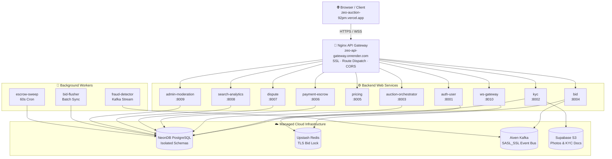
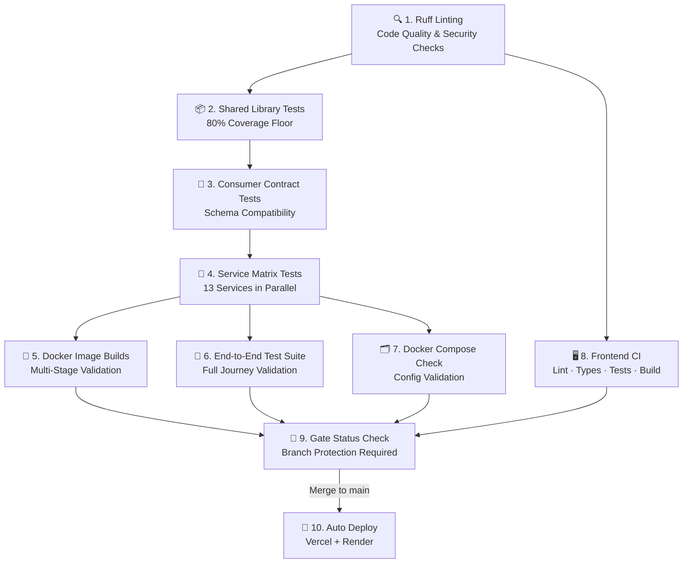

# ZeoAuction — Deployment, Hosting & Architecture Documentation

* **GitHub Repository**: [https://github.com/sagar-dot-bera/ZeoAuction](https://github.com/sagar-dot-bera/ZeoAuction)
* **Live Web Application**: [https://zeo-auction-92pm.vercel.app](https://zeo-auction-92pm.vercel.app)
* **Vercel Project Dashboard**: [https://vercel.com/kenji16/zeo-auction-92pm](https://vercel.com/kenji16/zeo-auction-92pm)
* **API Gateway (Render)**: [https://zeo-api-gateway.onrender.com](https://zeo-api-gateway.onrender.com)

---

This document outlines the deployment architecture, hosting infrastructure, routing via the API Gateway, CI/CD pipelines, and security configurations for **ZeoAuction**.

---

## 1. System Architecture & Routing Flow

ZeoAuction employs a distributed microservice architecture. The frontend Single-Page Application (SPA) never connects directly to private backend databases or internal service ports; instead, all HTTP and WebSocket requests route through a centralized **Nginx API Gateway**.

### High-Level Request Flow



### Gateway Route Mapping Table

The API Gateway (`infra/nginx/default.conf.template`) reverse-proxies requests according to specific prefix matches:

| Incoming Path Pattern | Routed Microservice | Purpose |
| :--- | :--- | :--- |
| `GET /healthz`, `GET /readyz` | **Gateway Internal** | Gateway liveness and readiness probe |
| `~ ^/api/v1/auctions/[^/]+/bids` | `bid` service | High-throughput bid submission & bid history |
| `/api/v1/auth/` | `auth-user` service | Registration, login, JWT token refresh, Gmail OTP |
| `/api/v1/kyc/` | `kyc` service | Aadhaar QR verification & KYC status checks |
| `/api/v1/admin/kyc/` | `kyc` service | Admin KYC review queue & document URL signing |
| `/api/v1/auctions/` | `auction-orchestrator` | Catalog, listing creation, image management, state transitions |
| `/api/v1/pricing/` | `pricing` service | Real-time increment calculation & reserve validation |
| `/api/v1/fees/`, `/api/v1/orders/` | `payment-escrow` | Invoicing, fee quotes, escrow ledger, Razorpay checkout |
| `/api/v1/webhooks/` | `payment-escrow` | Razorpay webhook authorization & capture callbacks |
| `/api/v1/disputes/` | `dispute` service | Buyer dispute filing, evidence attachment, resolution |
| `/api/v1/search/` | `search-analytics` | Search indexing, catalog filtering, view tracking |
| `/api/v1/admin/` | `admin-moderation` | Moderation queue, listing approval/rejection, user bans |
| `/ws` | `ws-gateway` | Real-time WebSocket feed for live bids and timer countdowns |

---

## 2. Hosting Details

### A. Frontend Application (SPA)
* **Platform**: Vercel
* **Live App URL**: [zeo-auction-92pm.vercel.app](https://zeo-auction-92pm.vercel.app)
* **Framework**: React 18, Vite, TypeScript, Tailwind CSS
* **Build Command**: `npm run build`
* **Output Directory**: `dist`
* **Configuration**: Configured to point all API and WebSocket traffic directly to the deployed API Gateway URL via environment variables.

### B. API Gateway
* **Platform**: Render (Web Service)
* **Runtime**: Docker (`infra/nginx/Dockerfile`)
* **Base Image**: `nginx:1.27-alpine`
* **Port**: `80` (HTTP internally; Render terminates SSL on `443` HTTPS)
* **Health Check**: `/healthz`

### C. Backend Microservices
* **Platform**: Render (Web Services & Background Workers)
* **Runtime**: Python 3.11+ / Docker
* **Deploy Blueprints**: Managed under `deploy/render/*.yaml`
* **Services**:
  1. `auth-user` (Port 8000)
  2. `kyc` (Port 8000)
  3. `auction-orchestrator` (Port 8000)
  4. `bid` (Port 8000)
  5. `pricing` (Port 8000)
  6. `payment-escrow` (Port 8000)
  7. `dispute` (Port 8000)
  8. `search-analytics` (Port 8000)
  9. `admin-moderation` (Port 8000)
  10. `ws-gateway` (Port 8000)
  11. `fraud-detector` (Background worker)
  12. `bid-flusher` (Background worker)
  13. `escrow-sweep` (Scheduled cron worker)

### D. Cloud Managed Infrastructure
* **PostgreSQL Database**: **NeonDB** (Serverless PostgreSQL with SSL enforced). Individual microservices utilize isolated schemas (`auth`, `kyc`, `auction`, `bid`, `payment`, `dispute`, `search`, `admin`, `notify`, `fraud`).
* **In-Memory Cache & Lock Store**: **Upstash Redis** (Serverless Redis accessed over TLS `rediss://`).
* **Message Broker**: **Aiven Kafka** (Managed Kafka cluster accessed over `SASL_SSL` using `SCRAM-SHA-256`, strictly capped at 2 partitions per topic).
* **Object Storage**: **Supabase S3** (Compatible with AWS S3 APIs; buckets: `listing-images`, `kyc-documents`, `dispute-evidence`).
* **Payment Gateway**: **Razorpay** (Test mode with webhook verification).

---

## 3. Public URLs & Application Endpoints

### Live Environment Endpoints

| Component | Target URL | Protocol | Notes |
| :--- | :--- | :--- | :--- |
| **Frontend Application** | `https://zeo-auction-92pm.vercel.app`<br/>(Project: [`vercel.com/kenji16/zeo-auction-92pm`](https://vercel.com/kenji16/zeo-auction-92pm)) | HTTPS | Public Web Application on Vercel |
| **API Gateway** | `https://zeo-api-gateway.onrender.com` | HTTPS | Primary entry point for all REST endpoints |
| **WebSocket Stream** | `wss://zeo-api-gateway.onrender.com/ws` | WSS | Live auction bidding and timer stream |
| **Health Check** | `https://zeo-api-gateway.onrender.com/healthz` | HTTPS | Status code `200 OK` |
| **Readiness Check** | `https://zeo-api-gateway.onrender.com/readyz` | HTTPS | Status code `200 OK` |

### Frontend Environment Configuration

In the frontend build environment (`.env.production` or Vercel dashboard):

```env
# Disable in-browser mocks to connect to live services
ZEO_USE_MOCKS=false

# Point at the deployed Nginx API Gateway
ZEO_API_GATEWAY_URL=https://zeo-api-gateway.onrender.com
ZEO_API_URL=https://zeo-api-gateway.onrender.com
ZEO_WS_URL=wss://zeo-api-gateway.onrender.com/ws

# Featured live auctions displayed on catalog
ZEO_FEATURED_AUCTIONS=00000000-0000-4000-8000-000000000201
```

---

## 4. CI/CD Details

ZeoAuction uses **GitHub Actions** (`.github/workflows/ci.yml`) for end-to-end continuous integration and automated deployment verification. Every pull request and merge to `main` executes a rigorous pipeline.

### Pipeline Architecture



### Pipeline Stages
1. **Linting (`lint`)**:
   - Executes `ruff check .` across all Python code to enforce PEP 8, import cleanliness, and security static checks.
2. **Shared Library (`shared-library`)**:
   - Tests `libs/zeo-common` with an enforced **80% minimum coverage floor** (`--cov-fail-under=80`).
3. **Consumer Contract Tests (`contracts` & `contract-tests`)**:
   - Verifies schema compatibility between producer and consumer services (e.g. Auction $\leftrightarrow$ Bid, Payment $\leftrightarrow$ Escrow).
4. **Service-Level Matrix Testing (`services`)**:
   - Runs parallel pytest runners across all 13 microservices, enforcing individual 80% coverage floors.
5. **Multi-Stage Docker Image Build (`images`)**:
   - Validates that each service's Dockerfile builds cleanly using GitHub Actions caching (`type=gha`), preventing broken container images from merging.
6. **Docker Compose Validation (`compose`)**:
   - Executes `docker compose config --quiet` to ensure service dependency graphs and environment configurations remain valid.
7. **Frontend Quality Gate (`frontend`)**:
   - Installs dependencies, runs ESLint, verifies TypeScript types with `tsc -b`, executes Vitest unit suites, and compiles the production bundle with `npm run build`.
8. **Required Gate (`gate`)**:
   - Single required status check configured in GitHub branch protection rules; merges to `main` are strictly blocked if any job fails.
9. **Continuous Deployment (CD)**:
   - On successful merge to `main`, Render auto-deploy triggers via webhooks to update the API Gateway and backend services.
   - Vercel automatically deploys the frontend build with instant global CDN invalidation.

---

## 5. Security Configurations

### A. Network Isolation & Gateway Perimeter
- **Single Public Port Entry**: Individual backend microservices run within private subnets/isolated Docker networks. External traffic must pass through the Nginx gateway.
- **Route Whitelisting**: Nginx explicitly routes known API prefixes (`/api/v1/...`). Any unmapped routes receive an immediate `404 Not Found` response directly from Nginx, preventing internal path traversal.

### B. Authentication & Identity Management
- **Stateless HS256 JWTs**: Access tokens carry user identity (`sub`), user role (`buyer`, `seller`, `admin`), KYC verification status (`kyc_status`), and suspension state (`suspended`).
- **Short-Lived Access Tokens**: Access tokens expire in 15 minutes.
- **Hashed Refresh Tokens**: Refresh tokens are stored in the database as SHA-256 hashes (`hash_refresh_token`). Raw tokens are never stored, preventing token reuse even in the event of database exposure.
- **Service-to-Service Authorization**: Internal endpoints (such as order settlement triggered by auction completion) require an `INTERNAL_SERVICE_TOKEN` header verified by timing-safe string comparison.

### C. Cryptographic Aadhaar QR Verification
- **Offline Signature Check**: The KYC service performs offline verification of UIDAI Secure QR codes using UIDAI's 2048-bit RSA public key (`SHA256withRSA`).
- **Zero Plaintext PII Storage**: Aadhaar numbers and biometric frames are never persisted unhashed. Only verification state and approved signatures are recorded.

### D. Data Protection & In-Transit Encryption
- **Database (PostgreSQL)**: Connected via `sslmode=require&channel_binding=require` to NeonDB.
- **Cache (Redis)**: Connected exclusively over TLS (`rediss://`) with password authentication.
- **Event Bus (Kafka)**: Connected over `SASL_SSL` using `SCRAM-SHA-256` authentication.
- **HTTPS & WSS Enforced**: All communication between the client, gateway, and backend uses TLS 1.3 / 1.2.

### E. Payment & Webhook Security
- **HMAC-SHA256 Signature Verification**: Every Razorpay webhook received at `/api/v1/webhooks/razorpay` is validated against `RAZORPAY_WEBHOOK_SECRET` before processing.
- **Test Mode Key Guard**: Payment adapters reject non-test keys in development/staging environments (`rzp_test_` validation).
- **Idempotency Keys**: All financial transactions and bid submissions enforce `Idempotency-Key` headers to prevent double-charging or duplicate bids during network retries.

### F. CORS & Gateway Perimeter Security
- **Centralized Gateway CORS**: Handled directly at the Nginx API Gateway level (`infra/nginx/proxy_params` and `infra/nginx/default.conf.template`).
- **Dynamic Origin Matching**: Dynamically allows verified origins (Vercel deployments `https://*.vercel.app`, Render services `https://*.onrender.com`, and local development `http://localhost:*` / `http://127.0.0.1:*`).
- **Instant Preflight Resolution**: Preflight `OPTIONS` requests are resolved directly at the gateway with `204 No Content` and cached for 24 hours (`Access-Control-Max-Age: 86400`), reducing backend latency.
- **Upstream Conflict Protection**: Uses `proxy_hide_header` to strip any conflicting upstream CORS headers from backend services before emitting the gateway's verified headers.
- Security headers configured in Nginx proxy:
  ```nginx
  proxy_set_header Host $host;
  proxy_set_header X-Real-IP $remote_addr;
  proxy_set_header X-Forwarded-For $proxy_add_x_forwarded_for;
  proxy_set_header X-Forwarded-Proto $scheme;
  ```
