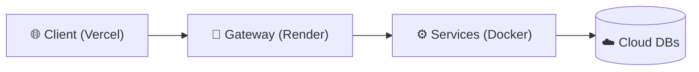
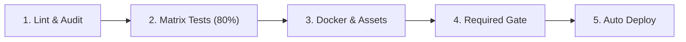

# ZeoAuction — Deployment, Hosting & Architecture Documentation

* **GitHub Repository**: [https://github.com/sagar-dot-bera/ZeoAuction](https://github.com/sagar-dot-bera/ZeoAuction)
* **Live Web Application**: [https://zeo-auction-92pm.vercel.app](https://zeo-auction-92pm.vercel.app)
* **Vercel Project Dashboard**: [https://vercel.com/kenji16/zeo-auction-92pm](https://vercel.com/kenji16/zeo-auction-92pm)
* **API Gateway (Render)**: [https://zeo-api-gateway.onrender.com](https://zeo-api-gateway.onrender.com)

---

This document outlines the deployment architecture, hosting infrastructure, routing via the API Gateway, CI/CD pipelines, and security configurations for **ZeoAuction**.

---

## 1. System Architecture & Routing Flow

ZeoAuction employs a distributed microservice architecture. The frontend Single-Page Application (SPA) routes all HTTP and WebSocket requests through a centralized **Nginx API Gateway**.

### High-Level Request Flow



### Gateway Route Mapping Table

The API Gateway (`infra/nginx/default.conf.template`) reverse-proxies requests according to specific prefix matches:

| Route Prefix | Target Service | Functionality |
| :--- | :--- | :--- |
| `GET /healthz`, `/readyz` | **Gateway Internal** | Liveness and readiness health probes |
| `/api/v1/auth/` | `auth-user` | Registration, login, JWT refresh, Gmail OTP |
| `/api/v1/users/` | `auth-user` | User profiles and category preferences |
| `/api/v1/kyc/` | `kyc` | Aadhaar Secure QR offline verification |
| `/api/v1/admin/kyc/` | `kyc` | Admin review queue & signed document URLs |
| `/api/v1/auctions/` | `auction-orchestrator` | Catalog, listing creation, lifecycle transitions |
| `/api/v1/bids/` | `bid` | High-throughput bid ingestion & price lock |
| `/api/v1/pricing/` | `pricing` | Real-time dynamic increment calculation |
| `/api/v1/orders/`, `/fees/` | `payment-escrow` | Invoicing, fee quotes, and escrow ledger |
| `/api/v1/webhooks/` | `payment-escrow` | Razorpay webhook signature verification |
| `/api/v1/disputes/` | `dispute` | Buyer dispute filing and evidence uploads |
| `/api/v1/search/` | `search-analytics` | Search indexing and catalog filtering |
| `/api/v1/admin/` | `admin-moderation` | Moderation queue, takedowns, user bans |
| `/ws` | `ws-gateway` | Real-time WebSocket bid & timer stream |

---

## 2. Hosting Details

### A. Frontend Application (SPA)
* **Platform**: Vercel
* **Live App URL**: [zeo-auction-92pm.vercel.app](https://zeo-auction-92pm.vercel.app)
* **Framework**: React 18, Vite, TypeScript, Tailwind CSS
* **Build Command**: `npm run build`
* **Output Directory**: `dist`
* **Configuration**: Points all API and WebSocket traffic to the deployed API Gateway URL via environment variables.

### B. API Gateway
* **Platform**: Render (Web Service)
* **Runtime**: Docker (`infra/nginx/Dockerfile`)
* **Base Image**: `nginx:1.27-alpine`
* **Port**: `80` (HTTP internally; Render terminates SSL on `443` HTTPS)
* **Health Check**: `/healthz`

### C. Backend Microservices
* **Platform**: Render (Web Services & Background Workers)
* **Runtime**: Python 3.11+ / Docker
* **Deploy Blueprints**: Managed under `deploy/render/*.yaml`
* **Services**:
  1. `auth-user` (Port 8000)
  2. `kyc` (Port 8000)
  3. `auction-orchestrator` (Port 8000)
  4. `bid` (Port 8000)
  5. `pricing` (Port 8000)
  6. `payment-escrow` (Port 8000)
  7. `dispute` (Port 8000)
  8. `search-analytics` (Port 8000)
  9. `admin-moderation` (Port 8000)
  10. `ws-gateway` (Port 8000)
  11. `fraud-detector` (Background worker)
  12. `bid-flusher` (Background worker)
  13. `escrow-sweep` (Scheduled cron worker)

### D. Cloud Managed Infrastructure
* **PostgreSQL Database**: **NeonDB** (Serverless PostgreSQL with SSL enforced). Individual microservices utilize isolated schemas (`auth`, `kyc`, `auction`, `bid`, `payment`, `dispute`, `search`, `admin`, `notify`, `fraud`).
* **In-Memory Cache & Lock Store**: **Upstash Redis** (Serverless Redis accessed over TLS `rediss://`).
* **Message Broker**: **Aiven Kafka** (Managed Kafka cluster accessed over `SASL_SSL` using `SCRAM-SHA-256`, strictly capped at 2 partitions per topic).
* **Object Storage**: **Supabase S3** (Compatible with AWS S3 APIs; buckets: `listing-images`, `kyc-documents`, `dispute-evidence`).
* **Payment Gateway**: **Razorpay** (Test mode with webhook verification).

---

## 3. Public URLs & Application Endpoints

### Live Environment Endpoints

| Component | Target URL | Protocol | Role |
| :--- | :--- | :--- | :--- |
| **Frontend Web App** | `https://zeo-auction-92pm.vercel.app` | HTTPS | Public Client on Vercel CDN |
| **API Gateway** | `https://zeo-api-gateway.onrender.com` | HTTPS | Centralized Reverse Proxy & CORS |
| **WebSocket Stream** | `wss://zeo-api-gateway.onrender.com/ws` | WSS | Live Auction Room Stream |
| **Health Check** | `https://zeo-api-gateway.onrender.com/healthz` | HTTPS | Gateway Liveness Probe (200 OK) |
| **Readiness Check** | `https://zeo-api-gateway.onrender.com/readyz` | HTTPS | Gateway Readiness Probe (200 OK) |

### Frontend Environment Configuration

In the frontend build environment (`.env.production` or Vercel dashboard):

```env
# Disable in-browser mocks to connect to live services
ZEO_USE_MOCKS=false

# Point at the deployed Nginx API Gateway
ZEO_API_GATEWAY_URL=https://zeo-api-gateway.onrender.com
ZEO_API_URL=https://zeo-api-gateway.onrender.com
ZEO_WS_URL=wss://zeo-api-gateway.onrender.com/ws

# Featured live auctions displayed on catalog
ZEO_FEATURED_AUCTIONS=00000000-0000-4000-8000-000000000201
```

---

## 4. CI/CD Details

ZeoAuction uses **GitHub Actions** (`.github/workflows/ci.yml`) for end-to-end continuous integration and automated deployment verification. Every pull request and merge to `main` executes a rigorous pipeline.

### Pipeline Architecture



### Pipeline Stages
1. **Linting (`lint`)**: Executes `ruff check .` across all Python code to enforce PEP 8, import cleanliness, and security static checks.
2. **Shared Library (`shared-library`)**: Tests `libs/zeo-common` with an enforced **80% minimum coverage floor** (`--cov-fail-under=80`).
3. **Consumer Contract Tests (`contracts` & `contract-tests`)**: Verifies schema compatibility between producer and consumer services.
4. **Service-Level Matrix Testing (`services`)**: Runs parallel pytest runners across all 13 microservices, enforcing individual 80% coverage floors.
5. **Multi-Stage Docker Image Build (`images`)**: Validates that each service's Dockerfile builds cleanly using GitHub Actions caching.
6. **Docker Compose Validation (`compose`)**: Executes `docker compose config --quiet` to ensure service dependency graphs remain valid.
7. **Frontend Quality Gate (`frontend`)**: Installs dependencies, runs ESLint, verifies TypeScript types with `tsc -b`, executes Vitest unit suites, and compiles production bundle.
8. **Required Gate (`gate`)**: Single required status check in GitHub branch protection; merges are strictly blocked if any job fails.
9. **Continuous Deployment (CD)**: Render auto-deploy triggers via webhooks; Vercel deploys frontend build with global CDN invalidation.

---

## 5. Security Configurations

### A. Network Isolation & Gateway Perimeter
- **Single Public Port Entry**: Microservices run within private subnets/Docker networks; external traffic must pass through the Nginx gateway.
- **Route Whitelisting**: Nginx explicitly routes known API prefixes (`/api/v1/...`). Any unmapped routes receive an immediate `404 Not Found` directly from Nginx.

### B. Authentication & Identity Management
- **Stateless HS256 JWTs**: Access tokens carry identity (`sub`), role (`buyer`, `seller`, `admin`), KYC status (`kyc_status`), and status (`suspended`).
- **Short-Lived Access Tokens**: Access tokens expire in 15 minutes.
- **Hashed Refresh Tokens**: Refresh tokens are stored strictly as SHA-256 hashes (`hash_refresh_token`).
- **Service Authorization**: Internal endpoints require an `INTERNAL_SERVICE_TOKEN` verified by timing-safe string comparison.

### C. Cryptographic Aadhaar QR Verification
- **Offline Signature Check**: The KYC service performs offline verification of UIDAI Secure QR codes using UIDAI's 2048-bit RSA public key (`SHA256withRSA`).
- **Zero Plaintext PII Storage**: Aadhaar numbers and biometric frames are never persisted unhashed. Only verification state is recorded.

### D. Data Protection & In-Transit Encryption
- **Database (PostgreSQL)**: Connected via `sslmode=require&channel_binding=require` to NeonDB.
- **Cache (Redis)**: Connected exclusively over TLS (`rediss://`) with password authentication.
- **Event Bus (Kafka)**: Connected over `SASL_SSL` using `SCRAM-SHA-256` authentication.
- **HTTPS & WSS Enforced**: All traffic between client, gateway, and backend uses TLS 1.3 / 1.2.

### E. Payment & Webhook Security
- **HMAC-SHA256 Signature Verification**: Every Razorpay webhook is validated against `RAZORPAY_WEBHOOK_SECRET` before processing.
- **Idempotency Keys**: Financial transactions and bid submissions enforce `Idempotency-Key` headers to prevent double-charging or duplicate bids.

### F. CORS & Gateway Error Shield
- **Centralized Gateway CORS**: Handled directly at Nginx (`infra/nginx/proxy_params` and `infra/nginx/default.conf.template`).
- **Dynamic Origin Matching**: Dynamically allows verified origins (Vercel deployments, Render services, and local development).
- **Error Shield**: Nginx intercepts 502/503/504 errors and returns structured JSON with CORS headers instead of raw HTML error pages.
