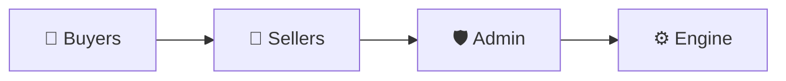
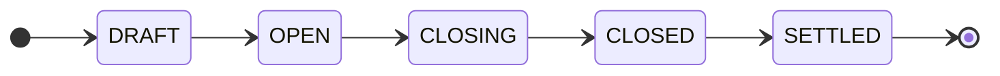
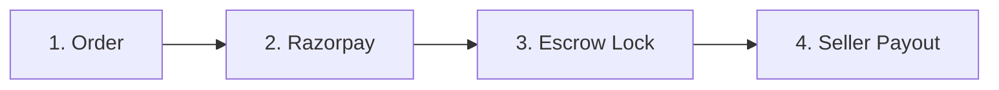
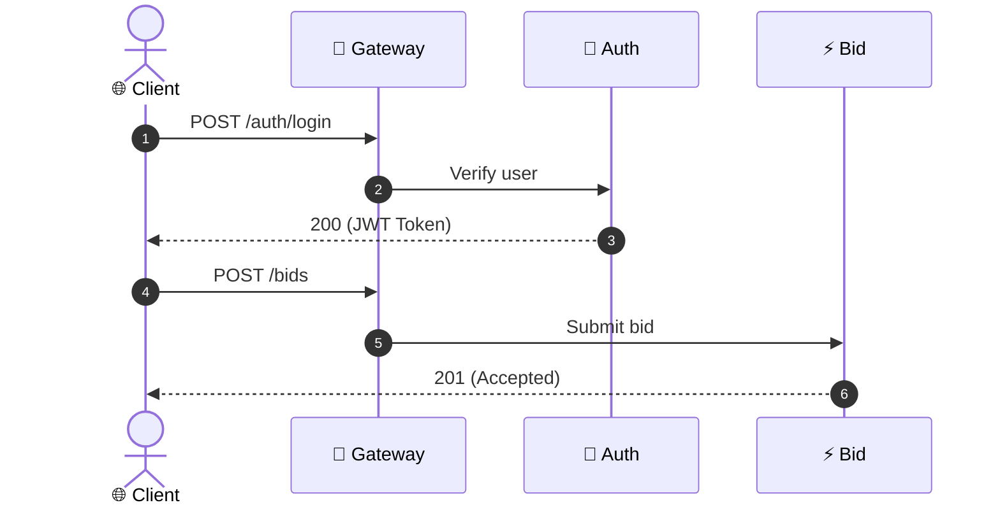
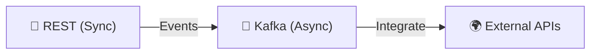

# ZeoAuction — Feature Set, Full-Stack & API Integration Guide

* **GitHub Repository**: [https://github.com/sagar-dot-bera/ZeoAuction](https://github.com/sagar-dot-bera/ZeoAuction)
* **Live Web Application**: [https://zeo-auction-92pm.vercel.app](https://zeo-auction-92pm.vercel.app)
* **API Gateway (Render)**: [https://zeo-api-gateway.onrender.com](https://zeo-api-gateway.onrender.com)

---

This document provides a concise architectural guide for the **ZeoAuction** platform, covering the platform features, full-stack tiers, and synchronous vs. asynchronous API integrations.

---

## 1. Complete Feature Set (Fully Functional App)

ZeoAuction serves three primary user roles: **Buyers**, **Sellers**, and **Administrators**, supported by an autonomous background engine.

### Feature Architecture

### A. Authentication, User Management & Verification
- **Email Verification & Registration**: Email, password, and display name registration with 6-digit Gmail OTP verification.
- **Stateless JWT Sessions**: 15-minute access tokens carrying `sub`, role (`buyer`, `seller`, `admin`), and `kyc_status`.
- **Hashed Refresh Tokens**: Stored strictly as SHA-256 hashes (`hash_refresh_token`) with rotation on every refresh.
- **Role & KYC Middleware**: Uniform authorization gating on protected endpoints.

### B. Seller Onboarding & KYC Verification Gate
- **Pre-Listing Gate**: Listing creation is strictly gated by approved seller KYC (`kyc_status: approved`).
- **Aadhaar Secure QR Upload**: Photograph or scan upload of UIDAI Secure QR code.
- **Offline Cryptographic Check**: Offline verification against UIDAI's 2048-bit RSA public key (`SHA256withRSA`).
- **Private S3 Storage**: Document images stored in private Supabase S3 buckets with time-limited presigned URLs.

### C. Catalog & Auction Lifecycle Orchestration
- **Listing Creation**: Multi-photo uploads, reserve price, increment rules, and scheduled duration.
- **State Machine**: Predictable auction lifecycle transitions:

- **Anti-Snipe Guard**: Bids in the final minutes automatically extend the clock by 60 seconds.

### D. Real-Time High-Throughput Bidding
- **In-Memory Lock**: Sub-millisecond atomic price locking in Upstash Redis.
- **Idempotency Protection**: Every bid requires an `Idempotency-Key` header to prevent duplicate bids.
- **Dynamic Increment Pricing**: Automated bid increment adjustments based on current price brackets.
- **WebSocket Gateway (`ws-gateway`)**: Real-time push of bid changes and countdown timers to connected browsers.
- **Batch Persistence (`bid-flusher`)**: High-velocity bids buffered in memory and flushed to PostgreSQL in batches of 500.

### E. Post-Auction Settlement & Escrow
- **Order Generation**: Automatic order created for the highest bidder when auction closes.
- **Razorpay Checkout**: Test-mode payment integration with cryptographic HMAC-SHA256 webhook capture.
- **Double-Entry Escrow Ledger**: Captured funds held in simulated escrow (`payment.escrow_ledger`).

### F. Dispute Resolution & Platform Trust
- **Dispute Filing**: Buyers can dispute an order during the 48-hour inspection window.
- **In-Flight Fraud Detection**: Real-time Kafka consumer detecting velocity spikes and shill bidding.
- **Admin Portal**: Identity review queue, fraud monitoring, audit logs, and dispute adjudication.

---

## 2. Frontend + Backend + Database Integration

### Real-Time Bidding & Auth Flow

### Full-Stack Architecture Tiers

| Tier | Technology | Core Responsibilities |
| :--- | :--- | :--- |
| **Frontend** | React 18, Vite, TypeScript | SPA client, live WebSocket connection, JWT session management |
| **Gateway** | Nginx Reverse Proxy | Centralized CORS, SSL termination, path routing, WebSocket upgrade |
| **Backend** | 13 FastAPI Microservices | Stateless REST APIs, circuit breakers, standardized JSON envelopes |
| **Database** | NeonDB PostgreSQL | Per-service schema isolation, append-only ledgers, SSL enforced |
| **Cache** | Upstash Redis | Sub-millisecond atomic bid locking, idempotency store, TLS enabled |
| **Event Bus** | Aiven Kafka | Sequential event broker, partition by auction_id, SASL_SSL auth |

---

## 3. API Integration Architecture

ZeoAuction separates **synchronous REST** calls from **asynchronous Kafka event streaming**:

### A. Synchronous Contract Boundaries (REST)

| Contract | Caller $\to$ Target | Endpoint | Fallback Policy |
| :--- | :--- | :--- | :--- |
| **CT-1** | `bid` $\to$ `auction-orchestrator` | `GET /api/v1/auctions/{id}/state` | Circuit breaker (5 fails/10s); serves cached state if < 2s |
| **CT-2** | `auction-orchestrator` $\to$ `kyc` | *Direct Token Validation* | Reads `kyc_status` claim directly from signed JWT |
| **CT-3** | `bid` $\to$ `pricing` | `GET /api/v1/pricing/{id}/min-increment` | Falls back to cached increment; marks bid stale |
| **CT-4** | `auction-orchestrator` $\to$ `payment-escrow` | `POST /internal/orders` | Background retry worker with idempotency key |

### B. Asynchronous Event-Driven APIs (Kafka)

| Topic Name | Key | Event Types | Consumers & Actions |
| :--- | :--- | :--- | :--- |
| `bid.events` | `auction_id` | `BidPlaced`, `BidOutbid` | `pricing` increments, `bid-flusher` DB sync, `ws-gateway` live feed |
| `auction.events` | `auction_id` | `AuctionOpened`, `AuctionClosed` | `search-analytics` catalog indexing, `ws-gateway` status change |
| `payment.events` | `order_id` | `PaymentCaptured`, `EscrowReleased` | `auction-orchestrator` settlement, `escrow-sweep` timer cancel |

### C. Third-Party External API Integrations
1. **Razorpay Payments**: Checkout session generation and cryptographic webhook capture.
2. **Gmail SMTP**: Transactional 6-digit OTP delivery over TLS port 587.
3. **Supabase S3**: Presigned URLs for direct multi-part photo uploads.
4. **UIDAI Public Certificate Registry**: 2048-bit RSA offline verification of Aadhaar QR demographic data.

---

## 4. Verification & Testing Strategy

- **Unit Tests**: Enforced 80% minimum code coverage floor across all 13 microservices.
- **Contract Tests (`tests/contracts`)**: Schema compatibility and circuit-breaker verification.
- **End-to-End Suite (`tests/e2e`)**: Full user journey from seller KYC to bid close and settlement.
- **Frontend Vitest Suite (`npm run test`)**: 10 suites covering money, live WebSocket client, and form flows (66/66 passing).
