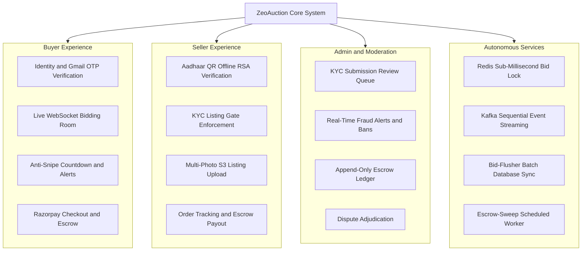
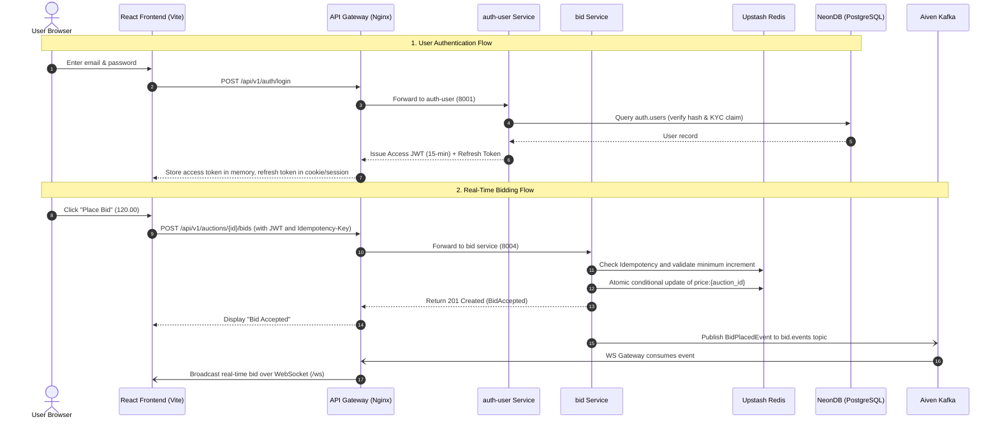
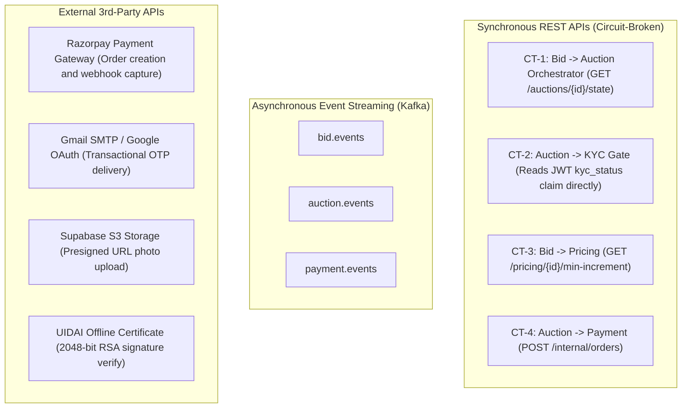

# ZeoAuction — Feature Set, Full-Stack & API Integration Guide

This document provides a comprehensive breakdown of the **ZeoAuction** platform, covering the complete functional feature set, the end-to-end integration between Frontend, Backend, and Database tiers, and synchronous vs. asynchronous API integration architectures.

---

## 1. Complete Feature Set (Fully Functional App)

ZeoAuction is designed with a **Trust and Safety First** philosophy, serving three primary user roles: **Buyers/Bidders**, **Sellers**, and **Administrators**.

### A. Authentication, User Management & Verification
- **Email Verification & Registration**: New users register with an email, password, and display name. Registration requires email verification via a 6-digit Gmail OTP or verification link before first login.
- **Stateless JWT Sessions**: 15-minute access tokens carry identity (`sub`), user role (`buyer`, `seller`, `admin`), KYC verification status (`kyc_status`), and account status (`suspended`).
- **Secure Refresh Token Rotation**: Refresh tokens are stored strictly as SHA-256 hashes (`hash_refresh_token`). A single refresh token rotation invalidates previous tokens and issues a new pair.
- **Role & KYC Gating Middleware**: FastAPI dependency (`zeo_common.auth`) intercepts incoming requests and rejects unauthorized calls with uniform error envelopes.

### B. Seller Onboarding & KYC Verification Gate
- **Pre-Listing KYC Gate**: Sellers cannot draft or publish auctions without passing KYC verification (`kyc_status: approved`).
- **Aadhaar Secure QR Code Upload**: Sellers upload a photograph or scan of their UIDAI Secure QR code.
- **Offline Cryptographic Verification**: The `kyc` service parses the QR payload, extracts UIDAI XML demographic data, and verifies the 2048-bit RSA digital signature against UIDAI's offline public certificate (`SHA256withRSA`).
- **Document Management**: Verification documents and photos are stored in private Supabase S3 buckets with time-limited presigned URLs.

### C. Catalog, Listing & Lifecycle Orchestration
- **Listing Creation**: Verified sellers create listings specifying title, category, starting price, reserve price, increment rules, and scheduled duration.
- **Multi-Photo Management**: Sellers upload up to 6 photos (JPEG/PNG/WebP) directly streamed to S3-compatible storage.
- **Strict State Machine**: Auctions transition predictably:
  $$\text{DRAFT} \longrightarrow \text{SCHEDULED} \longrightarrow \text{OPEN} \longrightarrow \text{CLOSING} \longrightarrow \text{CLOSED} \longrightarrow \text{SETTLED / CANCELLED}$$
- **Anti-Snipe Extensions**: Bids placed in the final minutes automatically extend the auction clock to ensure fair closing.

### D. Real-Time High-Throughput Bidding
- **Sub-Millisecond Bid Ingestion**: Bids are validated against the current high bid and reserve rules using Upstash Redis.
- **Idempotency Protection**: Every bid submission requires an `Idempotency-Key` header; retries return the original accepted bid without duplicating entries.
- **Dynamic Increment Pricing**: The `pricing` service calculates dynamic minimum bid increments based on current bid brackets.
- **WebSocket Gateway (`ws-gateway`)**: Broadcasts real-time bid updates, countdown clocks, and outbid events to connected browser rooms.
- **Asynchronous Batch Flushing (`bid-flusher`)**: High-velocity in-memory bids are buffered in Redis/Kafka and flushed periodically to PostgreSQL in batches of 500 to protect the database from connection exhaustion.

### E. Post-Auction Settlement, Razorpay & Escrow
- **Automatic Order Generation**: When an auction closes, the system generates an order and invoices the winning bidder.
- **Razorpay Checkout Integration**: Winners pay via Razorpay Checkout in test mode.
- **Webhook Authorization**: Payments are authorized and captured via cryptographic webhook signatures (`RAZORPAY_WEBHOOK_SECRET`).
- **Double-Entry Escrow Ledger**: Captured funds are deposited into an append-only simulated escrow ledger (`payment.escrow_ledger`).
- **Buyer Protection Window & Sweep**: Funds remain locked in escrow for a designated protection period. If no dispute is lodged, the `escrow-sweep` cron worker automatically settles and releases seller payout.

### F. Dispute Resolution & Platform Trust
- **Dispute Filing**: Buyers can open a dispute before the protection window closes, providing reasons and image evidence.
- **In-Flight Fraud Detection**: The `fraud-detector` worker consumes the Kafka `bid.events` stream in real time, detecting suspicious shill bidding or velocity spikes.
- **Admin Moderation Portal**: Administrators review pending KYC submissions, monitor fraud alerts, inspect immutable audit logs, and adjudicate disputes.

---

## 2. Frontend + Backend + Database Integration

### Full-Stack Architecture Tiers

| Tier | Component | Responsibilities & Integration Details |
| :--- | :--- | :--- |
| **Frontend Tier** | **React 18 SPA (TypeScript)** | • Clean component hierarchy with Tailwind CSS. • Dedicated API layer (`src/lib/api/index.ts`) abstracting network calls. • Centralized session manager with automatic JWT refresh on `401 UNAUTHENTICATED`. • Real-time WebSocket manager (`LiveClient`) with automatic reconnect and exponential backoff. • Configurable via `ZEO_API_GATEWAY_URL` and `ZEO_WS_URL`. |
| **Gateway Tier** | **Nginx Reverse Proxy** | • Listens on port 80/443; terminates public traffic. • Translates path routes (`/api/v1/...`) to internal backend service containers. • Upgrades HTTP connections to WebSocket protocols for `/ws`. • Standardizes proxy headers (`Host`, `X-Real-IP`, `X-Forwarded-For`). |
| **Backend Tier** | **13 FastAPI Microservices** | • Built on top of `libs/zeo-common`. • Standardized error envelopes (`code`, `message`, `details`, `request_id`). • Standardized health checks (`/healthz`, `/readyz`, `/metrics`). • Asynchronous I/O via Python `asyncio` and `httpx`. |
| **Database Tier** | **NeonDB PostgreSQL** | • **Schema Isolation**: Each service owns its schema (`auth`, `kyc`, `auction`, `bid`, `payment`, `dispute`, `search`, `admin`, `notify`, `fraud`). • **No Cross-Schema Foreign Keys**: Loose coupling using standard UUIDs. • **Append-Only Guarantees**: Database triggers prevent `UPDATE` and `DELETE` operations on audit and ledger tables. • **Enforced Encryption**: Connections require `sslmode=require`. |
| **Cache Tier** | **Upstash Redis** | • Ephemeral, high-velocity data store. • Manages bid locking, idempotency keys (`idem:{key}`), and active room connections. • Connected via TLS (`rediss://`). |
| **Event Tier** | **Aiven Kafka** | • Asynchronous backbone for service decoupling. • Partitioned strictly by `auction_id` for deterministic sequential processing. • Authenticated via `SASL_SSL` and `SCRAM-SHA-256`. |

---

## 3. API Integration (On-Need Basis)

ZeoAuction enforces a strict distinction between **synchronous REST** calls and **asynchronous event-driven** calls. Synchronous HTTP is used only when the caller cannot proceed without an immediate answer. All other side effects are handled asynchronously through Kafka.

### A. Synchronous Contract Boundaries (REST)

The four synchronous boundaries are governed by consumer contract tests (`tests/contracts`) and protected by circuit breakers:

| Contract ID | Caller $\to$ Target | Endpoint | Fallback Policy on Failure |
| :--- | :--- | :--- | :--- |
| **CT-1** | `bid` $\to$ `auction-orchestrator` | `GET /api/v1/auctions/{id}/state` | Circuit breaker trips after 5 failures in 10s. Serves cached state if $< 2\text{s}$ old; otherwise raises `AUCTION_STATE_UNAVAILABLE`. |
| **CT-2** | `auction-orchestrator` $\to$ `kyc` | *Zero Network Call* | Zero network call on the critical path. The listing gate validates the seller's `kyc_status` claim directly from the cryptographically signed JWT. |
| **CT-3** | `bid` $\to$ `pricing` | `GET /api/v1/pricing/{id}/min-increment` | Falls back to last cached increment; marks bid as `increment_stale`. |
| **CT-4** | `auction-orchestrator` $\to$ `payment-escrow` | `POST /internal/orders` | Auction remains `CLOSED`; background timer retries order creation with the same `Idempotency-Key`. |

### B. Asynchronous Event-Driven APIs (Kafka)

All cross-service data projections and reactive actions occur asynchronously over Kafka topics:

| Topic Name | Key | Event Types | Consumers & Actions |
| :--- | :--- | :--- | :--- |
| `bid.events` | `auction_id` | `BidPlaced`, `BidOutbid` | • **pricing**: Recalculates dynamic bracket increments. • **bid-flusher**: Buffers and persists accepted bids to database. • **fraud-detector**: Evaluates real-time bid velocity and shill scoring. • **ws-gateway**: Pushes real-time updates to connected browsers. |
| `auction.events` | `auction_id` | `AuctionOpened`, `AuctionClosing`, `AuctionClosed` | • **search-analytics**: Updates full-text search index. • **ws-gateway**: Emits lifecycle status changes to room participants. |
| `payment.events` | `order_id` | `PaymentCaptured`, `EscrowReleased`, `DisputeOpened` | • **auction-orchestrator**: Marks auction as `SETTLED`. • **escrow-sweep**: Cancels automatic sweep timer if dispute opened. • **ws-gateway**: Emits payment confirmation to buyer. |

### C. Third-Party External API Integrations

1. **Razorpay Payments**:
   - `orders.create`: Initiates payment session when winner proceeds to checkout.
   - Webhook verification: Validates `payment.authorized` events using HMAC-SHA256 signatures before capturing funds to escrow.
2. **Gmail SMTP Service**:
   - Sends transactional 6-digit OTP verification codes via TLS port 587 using Google App Passwords.
3. **Supabase S3 API**:
   - Generates presigned URLs for direct multi-part photo uploads, reducing server CPU and memory overhead.
4. **UIDAI Public Certificate Registry**:
   - Offline verification of Aadhaar QR demographic data using UIDAI's trusted certificate root (`SHA256withRSA`).

---

## 4. Verification & Testing Strategy

The integrated platform is protected by a multi-tier testing suite:
- **Unit Tests**: Executed across all 13 services with an enforced 80% code coverage threshold.
- **Contract Tests (`tests/contracts`)**: Verifies that synchronous schema models and circuit breaker fallbacks strictly comply with API agreements.
- **End-to-End Suite (`tests/e2e`)**: Validates complete user journeys (seller KYC $\to$ listing creation $\to$ live bidding $\to$ auction close $\to$ payment capture $\to$ escrow sweep).
- **Frontend Vitest Suite (`npm run test`)**: 10 test suites covering mock services, money formatting, WebSocket live client reconnection, and form validation.
