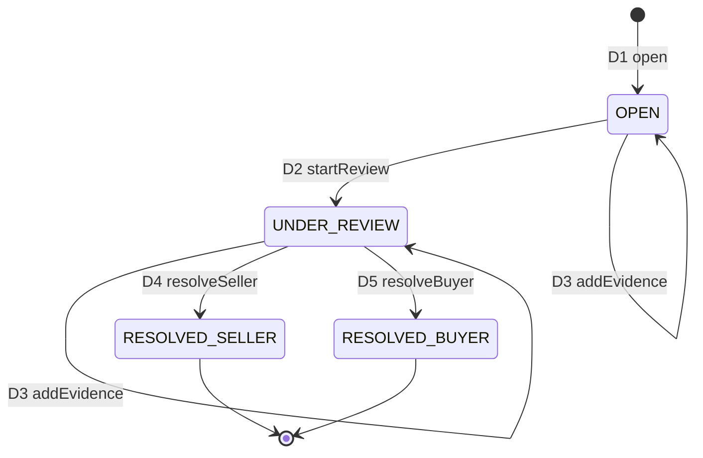

# Dispute lifecycle — draft spec

| | |
|---|---|
| **Owner** | Jay (Dispute Management, Admin & Moderation) |
| **Jira** | #84 (pulled forward from Plan 6), with #83 audit log |
| **Status** | **Draft**, written in Plan 4 so Plan 6 starts from an agreed spec. Not yet signed off |
| **Grounded in** | `docs/state-machines.md` §2 (O7, O8, O11, O12) and §4 (D1–D5), `infra/postgres/init/70-dispute.sql`, `config/settlement-policy.yaml`, SDD 4.3.3, 5.2.4, 6.6, 7.5, 8.6, 8.7 |

## 1. What a dispute is

A dispute is a **long-running human workflow** about one order whose money is in escrow. It never writes the ledger.
Dispute Management sends **freeze**, **release** and **refund** commands to Payment over a published contract, and
Payment owns the money (SDD 5.2.4). If Dispute Management is down, undisputed orders keep settling: the sweep and buyer
confirmation don't depend on it, only on the R1 guard ("no open dispute"), which Payment evaluates.

A dispute is opened by one of:

| `opened_by` | Who | When | Order transition |
|---|---|---|---|
| `BUYER` | The winning buyer (`opened_by_user_id`) | Order `SHIPPED` and `now < protection_window_ends_at` (7 days after shipping) | O7 `raiseDispute` |
| `FRAUD_SERVICE` | Fraud Detection, from a shill alert (`fraud_alert_id`) | Order `IN_ESCROW` or `SHIPPED` | O8 `fraudDispute` |

At most **one unresolved dispute per order**, enforced by the partial unique index `disputes_one_open_per_order`.

## 2. States and transitions

| # | Event | From → To | Actor | Guard | Effect | Audit action |
|---|---|---|---|---|---|---|
| D1 | `open` | – → OPEN | Buyer, or the fraud service | O7 or O8 is allowed on the order (Payment answers); reason code from the enum; description ≤ 4000 chars | **freeze** command to Payment (order → DISPUTED), then the row is inserted. Refused freeze → nothing stored (§4) | `DISPUTE_OPEN` (actor `USER` or `SYSTEM`) |
| D2 | `startReview` | OPEN → UNDER_REVIEW | Admin | – | `updated_at` | `DISPUTE_START_REVIEW` |
| D3 | `addEvidence` | OPEN, UNDER_REVIEW → *same* | Buyer, seller, fraud service | Caller is a party (or the fraud service); photo/document ≤ 10 MB in `dispute-evidence` (encrypted bucket); object **key** stored, never a URL | `dispute_evidence` row: `PHOTO`, `DOCUMENT`, `BID_TRACE`, `SELLER_RESPONSE` | `DISPUTE_EVIDENCE_ADD` only when an admin adds it |
| D4 | `resolveSeller` | UNDER_REVIEW → RESOLVED_SELLER | Admin | Note required; `Idempotency-Key` | **release** command → O11 (`RELEASE −(captured_total − fee)`) | `DISPUTE_RESOLVE` |
| D5 | `resolveBuyer` | UNDER_REVIEW → RESOLVED_BUYER | Admin | Note **and fault** (`BUYER`/`SELLER`/`PLATFORM`) required; `Idempotency-Key` | **refund** command with the fault → O12 (fee treatment below) | `DISPUTE_RESOLVE` |

Anything not in this table is refused with `CONFLICT` (409) and changes nothing. `RESOLVED_*` are terminal; the order
is terminal too (RELEASED / REFUNDED), so no new dispute can be opened on it (FR-AO-6).

**Outcome and fault are separate inputs.** The admin picks the outcome (release to seller / refund buyer) and, for a
refund, who was at fault. The fee accounting follows from the fault (`config/settlement-policy.yaml`,
`refund_fee_treatment`), so nobody types a money amount:

| Fault | Payment writes | Buyer receives |
|---|---|---|
| BUYER | `REFUND −winning_bid` | Winning bid; ₹99.00 fee retained |
| SELLER | `COMPENSATION +fee`, `REFUND −captured_total` | Winning bid + fee |
| PLATFORM | `COMPENSATION +fee`, `REFUND −captured_total` | Winning bid + fee |

## 3. Windows and timing

- **Protection window**: 7 days from `markShipped` (`protection_window.days`). The API refuses a buyer dispute after it
  with `WINDOW_CLOSED` (409), whatever the UI shows (AC-11, SDD 7.5).
- **No dispute before shipping** from a buyer: the window hasn't opened. The fraud service may open one on an
  `IN_ESCROW` order (FR-DISP-6).
- **Sweep interaction**: the escrow-sweep releases expired windows within 5 minutes (AC-12) **only** when no dispute is
  `OPEN` or `UNDER_REVIEW` (guard R1). A dispute raised one second before expiry therefore holds the funds.
- **Review SLA**: the SDD sets none. Proposed for Plan 6: the admin queue sorts by `opened_at` and highlights disputes
  open for more than 72 h; no automatic outcome, because money moves only on an admin decision.

## 4. Consistency with Payment

- Payment is the authority on whether O7/O8 is allowed (window open, order not terminal). D1 calls Payment's
  **freeze** synchronously with the key `dispute:{id}:freeze` and inserts the dispute row only if Payment accepted;
  a refusal is returned to the caller (`WINDOW_CLOSED`, `CONFLICT`) and nothing is stored. If Payment is down, D1
  answers `SERVICE_UNAVAILABLE` and the buyer retries. The alternative, an outbox that always accepts and may later
  have to reverse, is open question 1. The draft prefers synchronous because a buyer told "your dispute is open"
  must have frozen funds. If the insert fails after a successful freeze, the retry with the same key is a no-op at
  Payment, so the two converge.
- D4/D5 send release/refund with keys `dispute:{id}:release` / `dispute:{id}:refund`. Payment stores the key with the
  ledger row under a unique constraint, so a double-clicked resolve converges on one effect, and the database also
  refuses a second RELEASE/REFUND row for the order.
- If the release/refund command fails, the dispute stays `UNDER_REVIEW` with the admin's decision recorded in the
  audit log; the admin retries with the same `Idempotency-Key`.

## 5. Audit

Every admin action and every money-moving decision appends one `admin.audit_log` row **in the same transaction** as the
state change, using `zeo_common.audit` (`write_audit(conn, AuditEntry(...))`). `before_state`/`after_state` hold the
dispute's `{state, fault, resolution_note}`; money in snapshots is a two-decimal string. The log is append-only: a
mistaken note is corrected by a new row, never an edit. Opening evidence files is audited like KYC documents
(`DISPUTE_EVIDENCE_VIEW`).

## 6. API surface (SDD 7.x, to be frozen as `contracts/openapi/dispute.v1.yaml` in Plan 6)

| Method | Path | Who | Notes |
|---|---|---|---|
| POST | `/api/v1/orders/{id}/disputes` | Buyer | D1; `reason_code`, `description`; `WINDOW_CLOSED` (409) after the window |
| GET | `/api/v1/disputes/{id}` | A party, admin | Includes evidence metadata; files via short-lived signed URLs |
| POST | `/api/v1/disputes/{id}/evidence` | A party, admin | D3; multipart upload to `dispute-evidence` |
| GET | `/api/v1/admin/disputes` | Admin | Queue: OPEN and UNDER_REVIEW, oldest first |
| POST | `/api/v1/admin/disputes/{id}/review` | Admin | D2 |
| POST | `/api/v1/admin/disputes/{id}/resolve` | Admin | D4/D5; `outcome`, `fault`, `note`; `Idempotency-Key` |

New error codes to register in `contracts/errors/`: `WINDOW_CLOSED`, `DISPUTE_ALREADY_OPEN`, `DISPUTE_NOT_REVIEWABLE`.

## 7. Open questions (decide before Plan 6 starts)

1. Synchronous freeze versus outbox (§4). Draft: synchronous.
2. Can a buyer **withdraw** a dispute? The schema has no `WITHDRAWN` state. Draft: no; the admin resolves for the
   seller with the note "withdrawn by buyer", which also releases the funds.
3. Should a fraud-opened dispute on an `IN_ESCROW` (not yet shipped) order block `markShipped`? Draft: yes, because the
   order is DISPUTED and O6 is only allowed from IN_ESCROW.
4. Evidence retention: purge `dispute-evidence` objects N days after resolution (as KYC documents do)? N is still to be
   agreed with the KYC retention owner.
