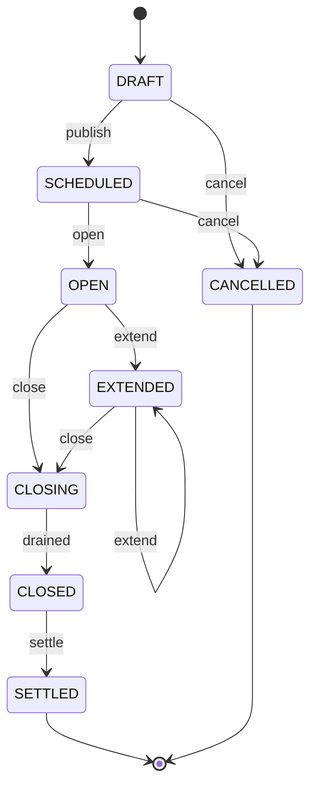
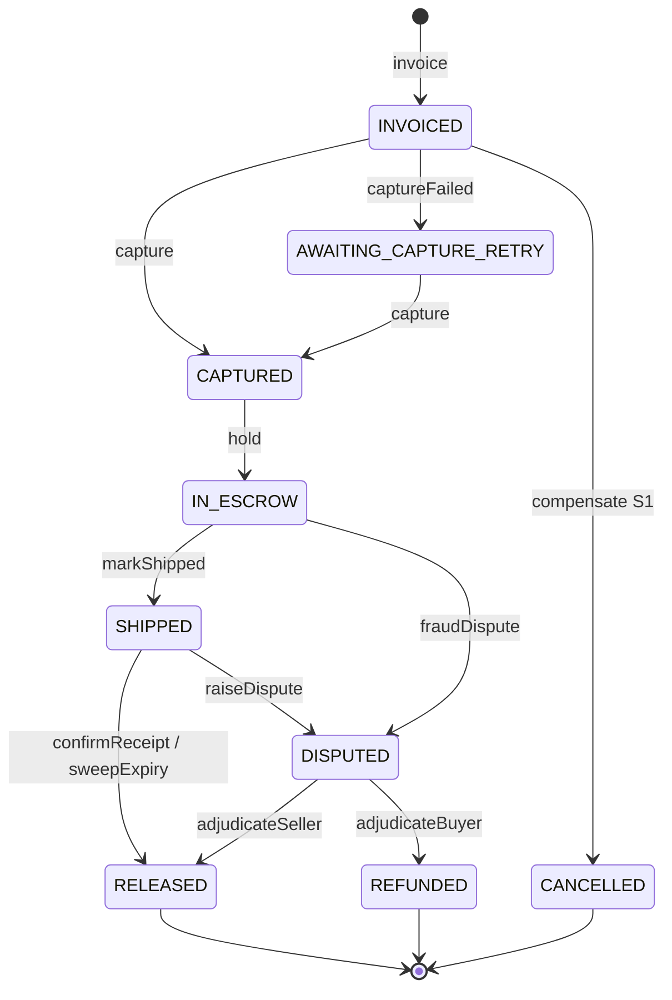
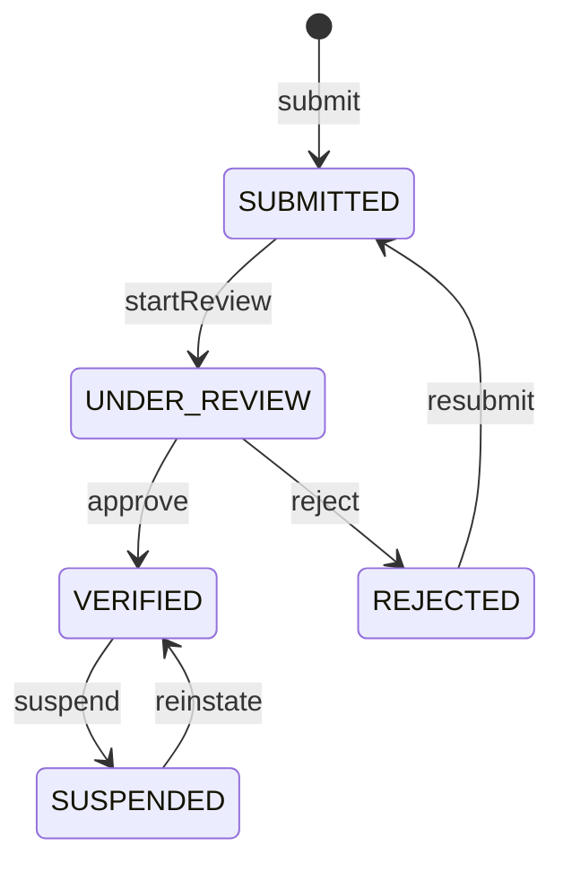

# State machines — transition tables

| | |
|---|---|
| **Jira** | #28 Specify auction lifecycle state machine as a transition table |
| **Owner** | Sumit (auction and order); KYC section reviewed by Sagar, dispute section by Jay |
| **Status** | Draft for team sign-off at the end of Plan 1 |
| **Source** | SDD 6.1–6.3, 6.6, Tables 6.1–6.3; proposal §5 settlement policy |

Every transition is specified here **before implementation**. That's the proposal's mitigation for the risk that escrow
and dispute states expand the state machine. Rules that apply to all four machines:

1. **Illegal transitions are rejected explicitly, not left undefined.** A transition missing from the table is
   refused, the service returns `409 CONFLICT` (or a more specific code), and nothing changes.
2. **Every accepted transition is recorded**, with its actor and timestamp, in the matching audit table
   (`auction_state_transitions`, `kyc_state_transitions`, the escrow ledger, `admin.audit_log`).
3. **Transitions use optimistic locking** (`version` column). If two concurrent transitions race, exactly one
   wins and the other re-reads the state and re-evaluates its guard.
4. **Terminal states are final.** After them, no event is accepted.

Configuration values such as the guard interval, extension cap, protection window and fee come from
[`config/settlement-policy.yaml`](../config/settlement-policy.yaml).

---

## 1. Auction lifecycle (Auction Orchestration, `auction.auctions.state`)

| # | Event | From | To | Guard (all must hold) | Effect | On guard failure |
|---|---|---|---|---|---|---|
| A1 | `publish` | DRAFT | SCHEDULED | Caller is the seller; JWT `kyc_status = VERIFIED`; not `suspended`; `opens_at` ≥ now; `closes_at` > `opens_at`; title, category and starting price are valid | Copies anti-snipe values from policy; emits `AuctionStateChanged` | `SELLER_NOT_VERIFIED` (403), `ACCOUNT_SUSPENDED` (403), `VALIDATION_ERROR` (422) |
| A2 | `open` | SCHEDULED | OPEN | `opens_at` reached (system timer) | Emits event; bidding permitted | none (the timer retries) |
| A3 | `acceptBid` | OPEN, EXTENDED | *unchanged* | Bid validated by Bid Processing (CT-1 reports `bid_permitted = true`) | None on the auction row; the price lives in Redis | `AUCTION_NOT_OPEN` (409) |
| A4 | `extend` | OPEN, EXTENDED | EXTENDED | Accepted bid's `accepted_at` > `closes_at − guard_interval`; `extension_count < max_extensions` | `closes_at += extension_seconds`; `extension_count += 1`; emits event (WebSocket `auction_extended`) | Not an error: the bid stands and the auction simply isn't extended |
| A5 | `close` | OPEN, EXTENDED | CLOSING | `closes_at` reached (system timer) | Stops admitting bids; waits for the bid queue to drain | none |
| A6 | `drained` | CLOSING | CLOSED | All accepted bids with `server_seq` ≤ the last allocated are persisted (the flusher confirms) | Sets `winning_bid_id` = highest `server_seq` accepted bid (null if none); emits event (WebSocket `auction_closed`) | Retries until drained |
| A7 | `settle` | CLOSED | SETTLED | `winning_bid_id` not null; payment reports the order `IN_ESCROW`; **exactly once**, enforced by unique `payment.orders.auction_id` | Emits event | Stays CLOSED while the order is in `AWAITING_CAPTURE_RETRY` (settlement is deferred, never abandoned) |
| A8 | `cancel` | DRAFT, SCHEDULED | CANCELLED | Caller is the seller or an admin; **no accepted bids exist** | Emits event | `CONFLICT` (409) |

**Decisions made while writing this table:**

- **`CLOSING` is split into two steps (A5 then A6).** SDD Table 6.1's guard "closes_at reached and the bid queue drained" would otherwise need to be checked atomically in one step. Splitting it lets a bid in flight at the deadline be sequenced and then either persisted or rejected with `AUCTION_CLOSED`.
- **Auctions with no bids stay `CLOSED`.** A7 requires a winner, so an auction that received no bids stays `CLOSED` permanently. We treat that as terminal, with no order created.
- **`AWAITING_CAPTURE_RETRY` is an order state, not an auction state** (SDD Table 2.2). The auction stays `CLOSED` until capture succeeds.
- **Once `OPEN`, only the timer or an admin ends an auction.** Cancelling an `OPEN` auction isn't allowed. Removing a live listing is done by an admin through moderation (Plan 6) and is recorded as `cancel` with admin actor. That path needs admin moderation, and is added as A9 when Plan 6 specifies it.

**Illegal (explicitly refused):** any event on SETTLED or CANCELLED; `publish` from anything but DRAFT;
`cancel` from OPEN/EXTENDED/CLOSING/CLOSED by the seller; `settle` twice.

---

## 2. Order settlement (Payment & Escrow, `payment.orders.state`)

| # | Event | From | To | Guard | Effect (ledger rows are append-only) |
|---|---|---|---|---|---|
| O1 | `invoice` | – | INVOICED | Auction CLOSED with a winner; **losing bidders are never invoiced** (AC-09) | Order + invoice: `total = winning_bid + convenience_fee`, stamped with the active `fee_version` (saga S1) |
| O2 | `capture` | INVOICED, AWAITING_CAPTURE_RETRY | CAPTURED | Manual capture through `PaymentPort` succeeds; key `order:{id}:capture` | `CAPTURE +captured_total` (S2) |
| O3 | `captureFailed` | INVOICED | AWAITING_CAPTURE_RETRY | Payment breaker open (3 failures / 30 s) or provider error | None; retried with the **same** idempotency key |
| O4 | `compensateS1` | INVOICED, AWAITING_CAPTURE_RETRY | CANCELLED | Capture definitively failed (retries exhausted) | Invoice `voided_at` set; alert raised. **No partial settlement remains** |
| O5 | `hold` | CAPTURED | IN_ESCROW | – | `HOLD 0` and `FEE_RETAIN −fee` (S3, S4) |
| O6 | `markShipped` | IN_ESCROW | SHIPPED | Caller is the seller | `shipped_at = now`, `protection_window_ends_at = now + 7 days`: **the protection window opens** |
| O7 | `raiseDispute` | SHIPPED | DISPUTED | Caller is the buyer; `now < protection_window_ends_at`; no open dispute | Escrow **frozen**. Refused with `WINDOW_CLOSED` (409) once the window has passed (AC-11) |
| O8 | `fraudDispute` | IN_ESCROW, SHIPPED | DISPUTED | Fraud alert for the auction (FR-DISP-6) | Escrow frozen; dispute opened with `opened_by = FRAUD_SERVICE` |
| O9 | `confirmReceipt` | SHIPPED | RELEASED | Caller is the buyer; no open dispute | Release trigger (a): `RELEASE −(captured_total − fee)` immediately |
| O10 | `sweepExpiry` | SHIPPED | RELEASED | `protection_window_ends_at ≤ now`; no open dispute | Release trigger (b), via the escrow-sweep cron **within 5 minutes** of expiry (AC-12) |
| O11 | `adjudicateSeller` | DISPUTED | RELEASED | Admin resolves `RELEASE_TO_SELLER` | Release trigger (c): `RELEASE −(captured_total − fee)` |
| O12 | `adjudicateBuyer` | DISPUTED | REFUNDED | Admin resolves `REFUND_BUYER` with a fault | See the fee table below; provider reversal of the capture |

**Guard shared by every release (R1):** no dispute in `OPEN` or `UNDER_REVIEW` exists for the order. If this guard fails, the release aborts and the funds stay held.
The database's partial unique index guarantees at most one `RELEASE`/`REFUND` row per order.

**Fee treatment on refund (SDD Table 6.3):**

| Fault | Ledger rows written | Buyer receives |
|---|---|---|
| BUYER | `REFUND −winning_bid` | Winning bid only; the fee is retained |
| SELLER | `COMPENSATION +fee` (reverses FEE_RETAIN), `REFUND −captured_total` | Winning bid + fee in full |
| PLATFORM | `COMPENSATION +fee`, `REFUND −captured_total` | Winning bid + fee in full |

**Invariant:** the ledger rows of every terminal order sum to zero. Also, `captured_total = winning_bid + fee` and
`seller_payout = captured_total − fee`. All of this is checked over 1000 settlements in Plan 7 (#67).

**Terminal:** RELEASED, REFUNDED and CANCELLED. Any later event, including a new dispute, is refused (FR-AO-6).

---

## 3. Seller verification (KYC, `kyc.kyc_submissions.state` mirrored to `auth.users.kyc_status`)

| # | Event | From | To | Guard | Effect |
|---|---|---|---|---|---|
| K1 | `submit` | – (user `NOT_SUBMITTED`) | SUBMITTED | Required documents uploaded and validated (type, size ≤ 10 MB, MIME) | Mirror `kyc_status` updated |
| K2 | `startReview` | SUBMITTED | UNDER_REVIEW | Admin opens the submission | Opening a document is itself audited |
| K3 | `approve` | UNDER_REVIEW | VERIFIED | Admin | Mirror → VERIFIED; `token_version += 1` **forces token refresh**, so the listing gate sees it immediately |
| K4 | `reject` | UNDER_REVIEW | REJECTED | Admin; **reason required** | Reason returned to the seller; upload re-enabled |
| K5 | `resubmit` | REJECTED | SUBMITTED | New documents | A new submission row (the old one is kept for audit) |
| K6 | `suspend` | VERIFIED | SUSPENDED | Admin; reason code required | Mirror → SUSPENDED; forced token refresh; listing refused |
| K7 | `reinstate` | SUSPENDED | VERIFIED | Admin | Mirror → VERIFIED; forced token refresh |

REJECTED is recoverable, not terminal. SUSPENDED is reversible.

---

## 4. Dispute (Dispute Management, `dispute.disputes.state`)

| # | Event | From | To | Guard | Effect |
|---|---|---|---|---|---|
| D1 | `open` | – | OPEN | Order transition O7 or O8 allowed | Sends a **freeze** command to Payment. Dispute never writes the ledger |
| D2 | `startReview` | OPEN | UNDER_REVIEW | Admin | Audited |
| D3 | `addEvidence` | OPEN, UNDER_REVIEW | *unchanged* | Buyer, seller or fraud service | Evidence row (photo, document, bid trace, seller response) |
| D4 | `resolveSeller` | UNDER_REVIEW | RESOLVED_SELLER | Admin; note required; `Idempotency-Key` | Sends a **release** command → order O11 |
| D5 | `resolveBuyer` | UNDER_REVIEW | RESOLVED_BUYER | Admin; note and **fault** required; `Idempotency-Key` | Sends a **refund** command with the fault → order O12 |

The admin chooses the **outcome** and the **fault** as separate inputs. The fee accounting is derived from the fault
automatically. Every action writes to `admin.audit_log`. The full lifecycle spec is finished in Plan 6 (#84).

---

## Sign-off

| Member | Section | Signed off |
|---|---|---|
| Sumit | Auction, Order | ☐ |
| Naitik | Auction guards A3–A6 (bid path) | ☐ |
| Jaydip | Order + fee table | ☐ |
| Sagar | Seller verification | ☐ |
| Jay | Dispute | ☐ |
| Harshal | O8 fraud path | ☐ |
