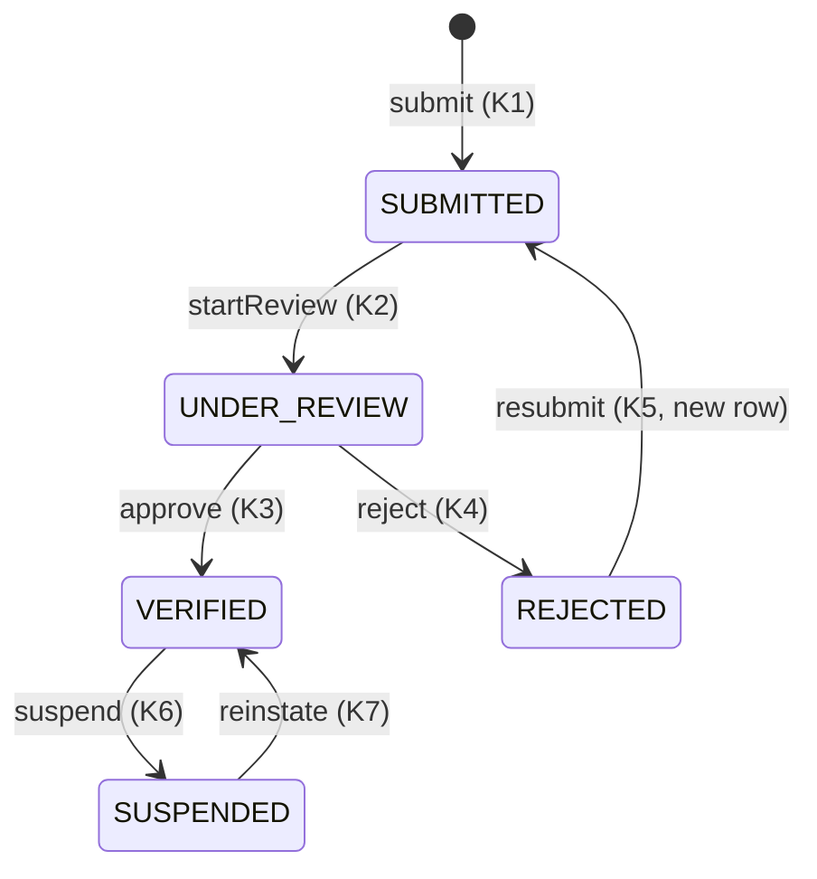

# KYC service — endpoint and verification-flow design

| | |
|---|---|
| **Owner** | Sagar |
| **Status** | Implemented in Plan 3 (#38–#41, #80). The decisions taken are listed in section 8; the service README is the current reference |
| **Sources** | SDD 4.2.1, 6.3 (Fig. 6.3), 6.7, 8.4, 8.8 · `docs/state-machines.md` §3 · `infra/postgres/init/20-kyc.sql` |
| **Reviewers** | Ayush (claim mirror, token refresh), Jay (admin screens), Sumit (state machine sign-off) |

This note settles the KYC API and flow on paper so Plan 3 is implementation, not design. Nothing here changes
the frozen schema. Where a decision is still open, it's listed at the end.

## 1. What the service owns

- **Seller verification state**: `kyc.kyc_submissions`, `kyc.kyc_documents` and the append-only `kyc.kyc_state_transitions`.
- **The claim mirror**: it's the only writer of `auth.users.kyc_status` and `token_version` (column-level grant, SDD 4.2.1).
- **Document bytes**: they're stored in the private, SSE-S3-encrypted `kyc-documents` bucket. Tables store object keys,
  never URLs.

It doesn't own the listing gate's decision. Auction Orchestration reads the `kyc_status` claim from the JWT (CT-2, ADR-0005),
so no listing request calls this service.

## 2. Verification state machine (transitions K1–K7)

Every accepted transition does the following, in **one database transaction**:

1. Update `kyc_submissions.state`, checking the expected `from` state (`UPDATE … WHERE id = $1 AND state = $from`). If 0 rows
   change, another admin won the race, and the service returns `409 CONFLICT`.
2. Insert a row in `kyc_state_transitions` with the actor, the reason and the timestamp.
3. Mirror the state to `auth.users.kyc_status` and **increment `token_version`** (K1, K3, K4, K6 and K7), so the user's next
   refresh carries the new claim.
4. Insert an `admin.audit_log` row for admin actions (K2–K4, K6 and K7).

| User status (`auth.users.kyc_status`) | Meaning |
|---|---|
| `NOT_SUBMITTED` | No submission row yet (the default) |
| `SUBMITTED`, `UNDER_REVIEW` | Waiting for an admin |
| `VERIFIED` | May list (the listing gate passes) |
| `REJECTED` | Must resubmit. The reason is shown to the seller |
| `SUSPENDED` | Listing is refused. Reversible by an admin |

**Illegal transitions** (for example approving a `SUBMITTED` row without starting review, or rejecting a `VERIFIED` one) return
`409 CONFLICT` with `details.state`, and nothing changes. That's the same rule as the other machines.

## 3. Endpoints

All of them are under `/api/v1`. Errors use the shared envelope. Every one requires a bearer token.

### Seller endpoints

| Method and path | Purpose | Success | Errors |
|---|---|---|---|
| `POST /kyc/submissions` | Create a submission with its documents (multipart: `government_id`, `proof_of_address`, optional `selfie`) | `201` + submission | `409 KYC_ALREADY_ACTIVE` (a live submission exists), `422 DOCUMENT_INVALID` (type, size or MIME), `413` |
| `GET /kyc/submissions/me` | Current status, the rejection reason if any, and document metadata (no URLs) | `200` | `404` if there's never been a submission |
| `POST /kyc/submissions/me/resubmit` | K5: new documents after a rejection. Creates a **new** row; the old one stays for audit | `201` | `409 CONFLICT` unless the latest row is `REJECTED` |

### Admin endpoints (role `ADMIN`, via `zeo_common.auth.AdminPrincipal`)

| Method and path | Transition | Body |
|---|---|---|
| `GET /admin/kyc/submissions?state=SUBMITTED` | Review queue, oldest first, paged | – |
| `POST /admin/kyc/submissions/{id}/start-review` | K2 | – |
| `GET /admin/kyc/submissions/{id}/documents/{doc_id}/url` | Viewing is **itself audited** (K2 note) | – → `{url, expires_in: 60}` |
| `POST /admin/kyc/submissions/{id}/approve` | K3 | – |
| `POST /admin/kyc/submissions/{id}/reject` | K4 | `{reason}`, required, 10–500 characters |
| `POST /admin/kyc/submissions/{id}/suspend` | K6 | `{reason_code}`, required |
| `POST /admin/kyc/submissions/{id}/reinstate` | K7 | – |

The admin endpoints live in this service, not in admin-moderation, because they write KYC-owned rows. The admin console
(Plan 6) calls them.

## 4. Documents

| Rule | Value | Enforced by |
|---|---|---|
| Types | `GOVERNMENT_ID`, `PROOF_OF_ADDRESS`, `SELFIE` | Schema CHECK |
| MIME | `image/jpeg`, `image/png`, `application/pdf`, sniffed from the bytes rather than trusted from the header | Service and schema CHECK |
| Size | ≤ 10 MB per file | Service and schema CHECK (`size_bytes <= 10485760`) |
| Object key | `kyc/{user_id}/{submission_id}/{doc_type}-{uuid}.{ext}` | Service. The schema refuses anything that looks like a URL |
| Integrity | `sha256` recorded at upload | Service |
| Access | Signed GET URL, **60 s** TTL, generated per view, never stored or logged | Service |
| Retention | `purge_after = decided_at + 90 days` for rejected submissions. Verified documents are kept while the account is active (retention ADR pending, FR-DOC-4) | Purge job (Plan 6) |

Uploads go through the service, not as presigned PUTs from the browser, so the MIME sniffing and size checks run before
anything is stored. Ten megabytes is small enough to stream through FastAPI.

**Privacy rules (NFR-SEC-2).** Document bytes, signed URLs and file names are never logged. The JSON logger only receives
ids. Only synthetic or consented sample documents are used, in development and in the demo.

## 5. Interaction with tokens (ADR-0005)

A seller who gets approved shouldn't have to wait up to 15 minutes for their access token to expire. So:

1. K3 increments `token_version` in the same transaction as the mirror update.
2. The SPA re-reads `GET /kyc/submissions/me` after each admin decision (by polling, or by the notification in Plan 3) and then calls
   `POST /auth/refresh`. The refreshed token carries `kyc_status = VERIFIED`, because the auth service re-reads claims on every refresh.
3. Plan 3 decision: whether services also refuse access tokens whose `tv` claim is older than `users.token_version` (this
   needs a cache lookup per request). For suspension that matters, because a suspended seller's existing token stays valid for up to 15 minutes. The proposal
   is to check `tv` only on listing creation, the one KYC-gated write.

## 6. Events

None in Plan 3. A `KycStatusChanged` event isn't in the frozen topic list, and nothing consumes it yet. If search or notifications
need it, it's added with a contract PR (`contracts/README.md`, rule 1).

## 7. Open questions (to settle at the Plan 3 kickoff)

1. Does approval of a resubmission (K5 then K3) need a different reviewer from the one who rejected it? This affects only the admin UI.
2. What's the retention period for verified documents? It's waiting on the retention ADR (FR-DOC-4).
3. Should the `tv` check run only on the listing gate, or everywhere (§5.3)?
4. Should `SELFIE` be required? The SDD lists it as optional; the proposal's demo flow doesn't use it.

## 8. Decisions taken in Plan 3

1. **Paths follow SDD 7.2**: the admin routes are `/api/v1/admin/kyc/queue` and `/api/v1/admin/kyc/{id}/...`, not
   `/admin/kyc/submissions/...`. `POST /kyc/submissions/{id}/documents` exists too, for adding a missing optional type
   (`SELFIE`) before review starts.
2. **Resubmission (K5) is `POST /kyc/submissions` again** once the latest submission is `REJECTED`; there is no separate
   `/resubmit` route.
3. **Token freshness (§5.3)**: every status change bumps `token_version` and publishes it to Redis (`tv:{user_id}`).
   Only the listing gate checks it, as proposed. The check fails closed if Redis is unreachable.
4. **The mirror changes on every transition**, K2 included, so the seller sees `UNDER_REVIEW`.
5. **`SELFIE` stays optional** (open question 4).
6. **Retention**: `purge_after = uploaded_at + KYC_RETENTION_DAYS` (365) until the retention ADR decides, because
   `kyc_svc` has no UPDATE grant on `kyc_documents` to move it at decision time.
